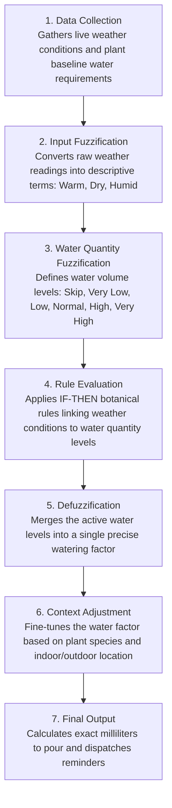

# Fuzzy Logic Watering System - Flowchart

A minimal, step-by-step flow of how the fuzzy logic engine determines plant watering needs, including both input and water quantity fuzzification.

---

---

## Step-by-Step Breakdown

### 1. Data Collection
- Retrieves live temperature, humidity, and rainfall from the weather service.
- Reads plant profile settings (base water volume in ml, environment, and pot dimensions).

### 2. Input Fuzzification
- Converts raw sensor values into descriptive linguistic categories:
  - **Temperature:** Freezing, Cold, Cool, Mild, Warm, Hot, Scorching Hot
  - **Humidity:** Dry, Comfortable, Humid
  - **Rainfall:** None, Light, Heavy

### 3. Water Quantity Fuzzification
- Defines fuzzy membership categories for the target water volume:
  - **Skip:** No water (0% – 20% of base)
  - **Very Low:** Minimal hydration (20% – 50% of base)
  - **Low:** Light watering (50% – 85% of base)
  - **Normal:** Standard watering (80% – 120% of base)
  - **High:** Increased hydration (105% – 135% of base)
  - **Very High:** Maximum hydration (125% – 160% of base)

### 4. Rule Evaluation
- Evaluates practical IF-THEN rules matching weather states to water quantity levels:
  - *IF Temperature is Hot AND Humidity is Dry THEN Water Quantity is Very High*
  - *IF Temperature is Cold AND Humidity is Humid THEN Water Quantity is Low*
  - *IF Rain is Heavy AND Plant is Outdoor THEN Water Quantity is Skip*

### 5. Defuzzification
- Combines all triggered water quantity levels using the Center of Area method into a single numerical factor (e.g., 1.25 for +25% water).

### 6. Context Adjustment
- Applies botanical adjustments based on environment and species habits:
  - **Indoor plants:** Sheltered from wind and direct sunlight swings.
  - **Outdoor plants:** Natural rain received is subtracted directly.
  - **Succulents & cacti:** Heat increases are dampened to prevent overwatering.

### 7. Final Output
- Calculates the final water volume in exact milliliters (e.g., 380 ml).
- Displays the recommendation on the plant dashboard and emails reminders to caretakers.
