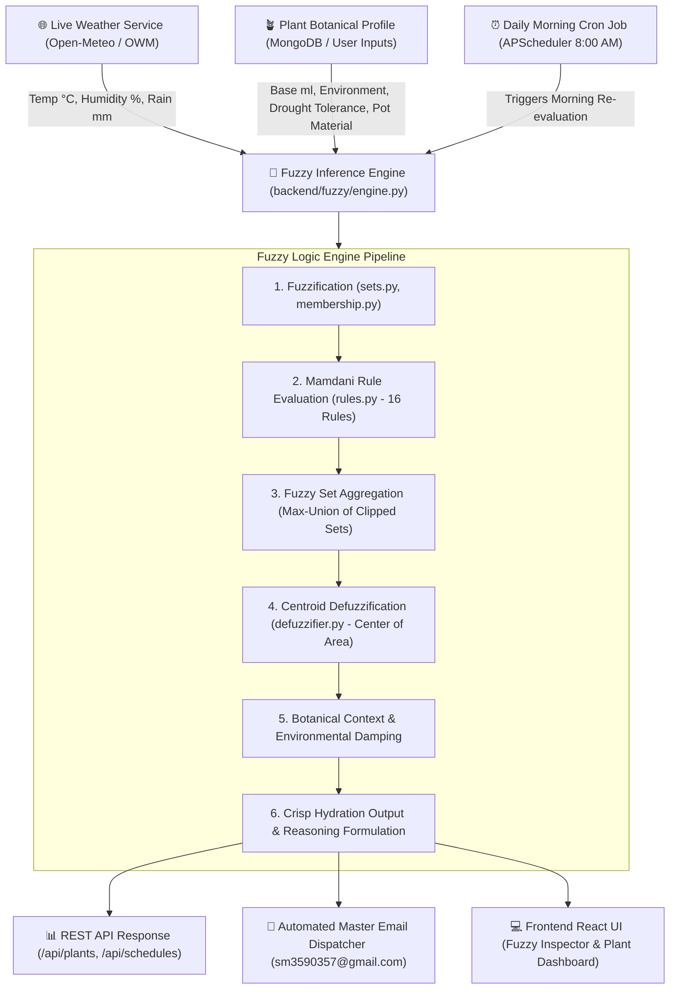
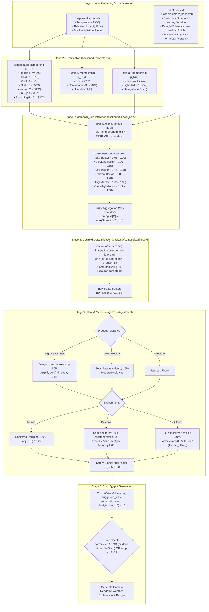
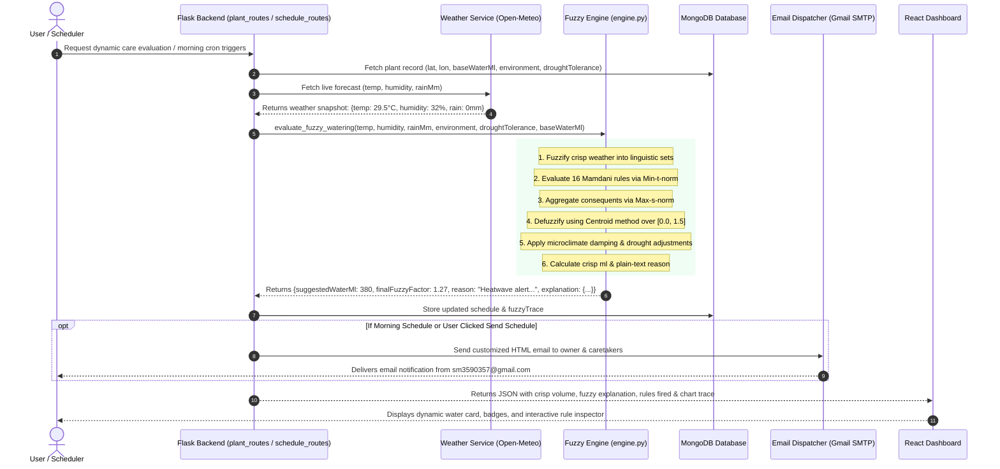

# Fuzzy Logic Implementation & Application Architecture Flow

This document details the internal working, mathematical design, and end-to-end execution flow of the **Fuzzy Logic Botanical Hydration Engine** within the *Hydrate your plant using fuzzy logic* application.

---

## 1. High-Level System Architecture Flow

---

## 2. Detailed Internal Fuzzy Processing Flowchart

---

## 3. Step-by-Step Execution Sequence

---

## 4. Mathematical Formulations

### 1. Membership Functions (`membership.py`)
- **Left-Shoulder Function:**
  $$\mu_L(x; a, b) = \begin{cases} 
  1.0 & x \le a \\
  \frac{b - x}{b - a} & a < x < b \\
  0.0 & x \ge b 
  \end{cases}$$

- **Triangular Function:**
  $$\mu_\Delta(x; a, b, c) = \begin{cases} 
  0.0 & x \le a \\
  \frac{x - a}{b - a} & a < x \le b \\
  \frac{c - x}{c - b} & b < x < c \\
  0.0 & x \ge c 
  \end{cases}$$

- **Right-Shoulder Function:**
  $$\mu_R(x; a, b) = \begin{cases} 
  0.0 & x \le a \\
  \frac{x - a}{b - a} & a < x < b \\
  1.0 & x \ge b 
  \end{cases}$$

---

### 2. Mamdani Inference & Aggregation (`rules.py`)
For each rule $R_i$:
$$\alpha_i = \min\big(\mu_{\text{temp}, i}(T), \mu_{\text{hum}, i}(H), \mu_{\text{rain}, i}(R)\big)$$

Aggregated consequent strength for each linguistic term $C \in \{\text{Skip, VeryLow, Low, Normal, High, VeryHigh}\}$:
$$\mu_{\text{agg}, C}(x) = \min\left( \max_{i \in R_C} (\alpha_i),\, \mu_C(x) \right)$$

Overall fuzzy output curve:
$$\mu_{\text{combined}}(x) = \max_{C} \big( \mu_{\text{agg}, C}(x) \big)$$

---

### 3. Centroid Defuzzification (`defuzzifier.py`)
Computes the center of gravity over the adjustment factor domain $[0.0, 1.5]$:
$$z^* = \frac{\int_{0.0}^{1.5} x \cdot \mu_{\text{combined}}(x) \, dx}{\int_{0.0}^{1.5} \mu_{\text{combined}}(x) \, dx}$$

---

### 4. Environmental Damping & Output Clamping
- **Indoor plants** (attenuated atmospheric variance):
  $$\text{factor}_{\text{indoor}} = 1.0 + (z^* - 1.0) \times 0.45$$
- **Balcony plants** (semi-protected):
  $$\text{factor}_{\text{balcony}} = 1.0 + (z^* - 1.0) \times 0.80 \quad (\times 0.65 \text{ if rain} \ge 5\text{mm})$$
- **Outdoor plants** (full rain subtraction):
  $$\text{factor}_{\text{outdoor}} = \max\left(0.05,\, z^* \times \left(1.0 - \min\left(0.85, \frac{\text{rain\_mm}}{10} \times 0.8\right)\right)\right)$$
- **Crisp Volume (ml):**
  $$V_{\text{suggested}} = \text{round}\left(\frac{V_{\text{base}} \times \text{clamp}(\text{factor}, 0.05, 1.60)}{10}\right) \times 10$$
