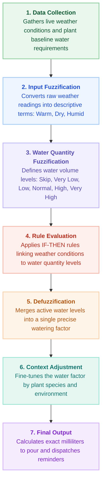

# Fuzzy Logic Watering System - Flowchart

A colorful, minimal step-by-step flowchart of how the fuzzy logic engine determines plant watering needs.

---

## Flowchart Image

---

## Mermaid Flowchart (Markdown)

---

## Step Summary

1. **1. Data Collection (Soft Green)**
   - Retrieves live weather conditions (temperature, humidity, rain) and baseline plant care settings.

2. **2. Input Fuzzification (Soft Blue)**
   - Converts numeric sensor readings into linguistic terms (*Freezing, Cold, Cool, Mild, Warm, Hot*, *Dry, Comfortable, Humid*, *Light, Heavy Rain*).

3. **3. Water Quantity Fuzzification (Soft Lavender)**
   - Defines output volume levels (*Skip, Very Low, Low, Normal, High, Very High*).

4. **4. Rule Evaluation (Soft Coral)**
   - Applies botanical IF-THEN rules linking weather states to water quantity levels.

5. **5. Defuzzification (Soft Amber)**
   - Merges active rule outputs using the Center of Area method into a single numerical factor.

6. **6. Context Adjustment (Soft Mint)**
   - Fine-tunes the factor based on species (succulent heat damping) and environment (sheltered indoor vs. direct outdoor rain).

7. **7. Final Output (Soft Violet)**
   - Calculates exact milliliters to pour and dispatches automated email notifications to caretakers.
