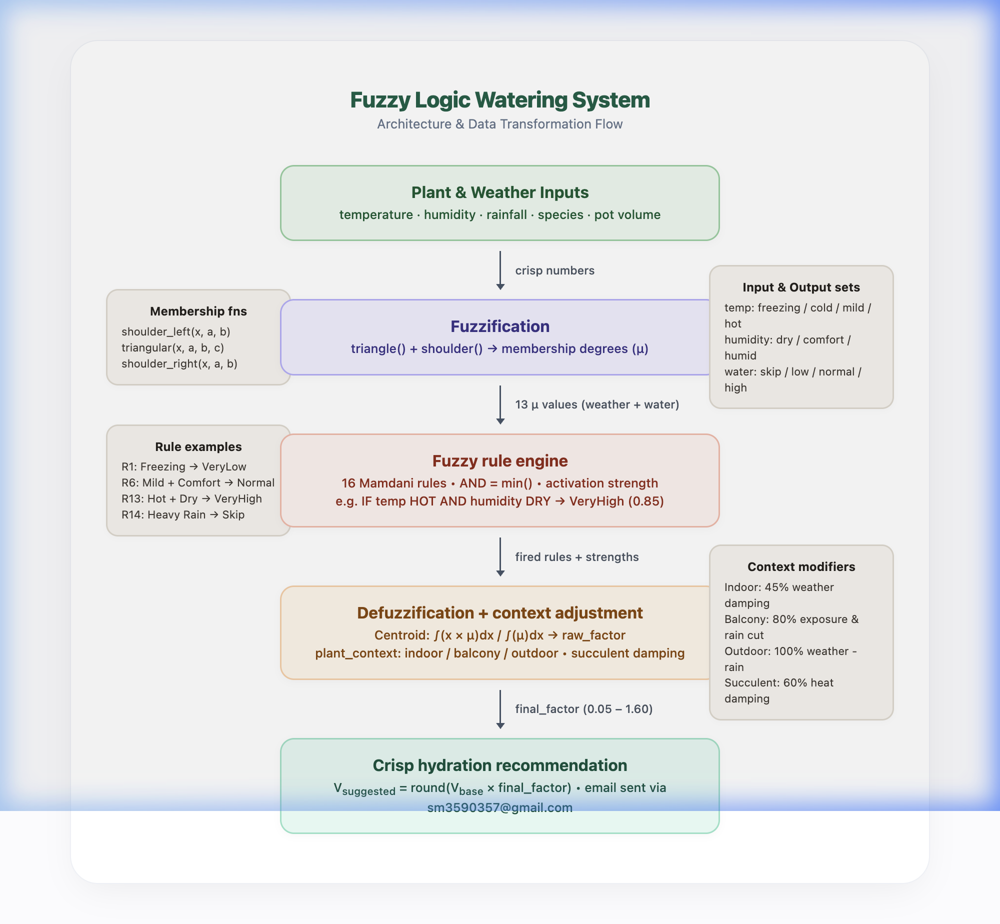

# Fuzzy Logic Watering System - Architecture Flow

A colorful, structured overview of the Mamdani fuzzy inference and defuzzification pipeline for the botanical hydration engine.

---

## Architecture Flowchart

---

## Pipeline Overview

### 1. Plant & Weather Inputs (Green)
- **Parameters:** Temperature, relative humidity, precipitation, plant species, and pot volume.
- **Data Type:** Crisp numbers obtained from the live weather service and database.

### 2. Fuzzification (Purple)
- **Core Function:** Converts crisp inputs into membership degrees ($\mu \in [0.0, 1.0]$) using triangular and shoulder curves.
- **Membership Functions (Left side):** `shoulder_left(x, a, b)`, `triangular(x, a, b, c)`, `shoulder_right(x, a, b)`.
- **Fuzzy Sets (Right side):**
  - **Temperature:** Freezing, Cold, Cool, Mild, Warm, Hot, Scorching Hot
  - **Humidity:** Dry, Comfortable, Humid
  - **Rainfall:** None, Light, Heavy
  - **Water Quantity:** Skip, Very Low, Low, Normal, High, Very High

### 3. Fuzzy Rule Engine (Coral / Pink)
- **Inference:** Evaluates 16 botanical rules using Mamdani Min-aggregation ($\alpha_i = \min(\dots)$).
- **Rule Examples (Left side):**
  - `R1: Freezing → VeryLow`
  - `R6: Mild + Comfortable → Normal`
  - `R13: Hot + Dry → VeryHigh`
  - `R14: Heavy Rain + Outdoor → Skip`

### 4. Defuzzification + Context Adjustment (Peach / Orange)
- **Defuzzification:** Computes the Center of Gravity (CoG / Centroid) over the output domain $[0.0, 1.5]$:
  $$z^* = \frac{\int x \cdot \mu(x) \, dx}{\int \mu(x) \, dx}$$
- **Context Modifiers (Right side):**
  - **Indoor plants:** 45% weather damping (sheltered microclimate).
  - **Balcony plants:** 80% weather exposure and rain deduction.
  - **Outdoor plants:** 100% weather exposure and full natural rain offset.
  - **Succulents & cacti:** 60% heat damping to prevent root saturation.

### 5. Crisp Hydration Recommendation (Mint)
- **Result:** Calculates the exact crisp target milliliters to pour:
  $$V_{\text{suggested}} = \text{round}(V_{\text{base}} \times \text{final\_factor})$$
- **Automated Dispatch:** Dispatches dynamic watering schedules and morning hydration alerts to caretakers via the master email dispatcher (`sm3590357@gmail.com`).
