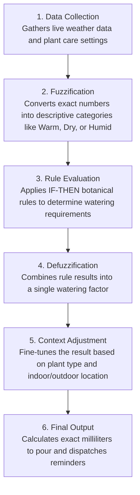

# Fuzzy Logic Watering System - Flowchart

A minimal, step-by-step flow of how the fuzzy logic engine determines plant watering needs.

---

---

## Process Breakdown

### 1. Data Collection
- Retrieves current temperature, humidity, and rainfall from the weather service.
- Reads plant profile details (base water amount, indoor or outdoor location, drought tolerance).

### 2. Fuzzification
- Converts raw measurements into human-like descriptive categories:
  - **Temperature:** Freezing, Cold, Cool, Mild, Warm, Hot
  - **Humidity:** Dry, Comfortable, Humid
  - **Rainfall:** None, Light, Heavy

### 3. Rule Evaluation
- Evaluates practical gardening rules based on combined conditions, for example:
  - *IF hot AND dry THEN increase water*
  - *IF cold AND humid THEN decrease water*
  - *IF heavy rain AND outdoor plant THEN skip watering*

### 4. Defuzzification
- Merges all active rule outputs into a single numerical adjustment factor (e.g., 1.25 for +25% water).

### 5. Context Adjustment
- Applies practical adjustments based on plant habits:
  - **Indoor plants:** Sheltered from wind and direct weather swings.
  - **Outdoor plants:** Accounts directly for natural rain received.
  - **Succulents & cacti:** Dampens high heat boosts to avoid overwatering.

### 6. Final Output
- Produces the final recommended volume in milliliters (e.g., 380 ml).
- Displays the recommendation on the dashboard and automatically emails reminders to caretakers.
